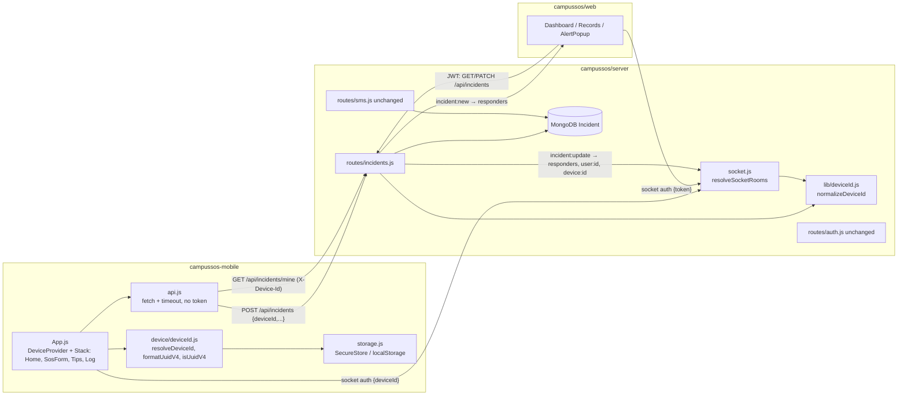
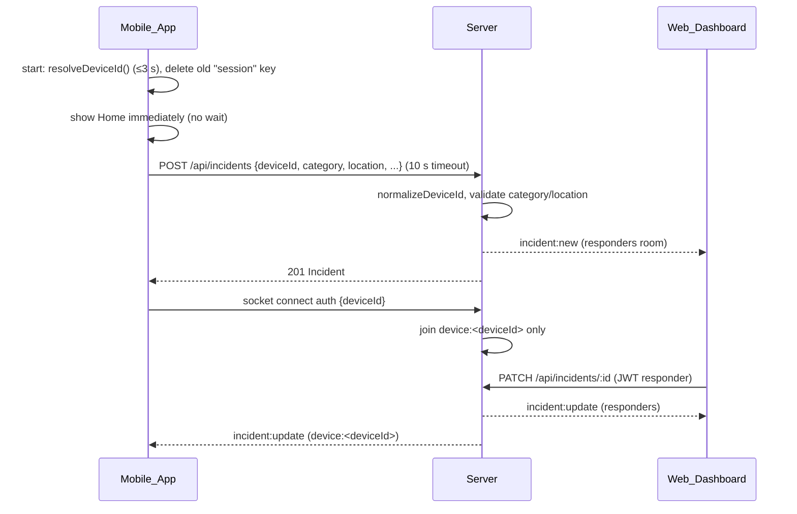

# Design Document: mobile-remove-auth

## Overview

This change removes the login/register flow from the CampusSOS mobile app (`campussos-mobile`). The app opens straight to the Home screen and identifies itself to the server with an anonymous **Device_ID** (a random UUID v4 generated on first launch and kept in the Device_Store). The server (`campussos/server`) accepts SOS submissions, incident-log requests, and status sockets keyed by Device_ID, while the responder-only endpoints, the `/api/auth/*` routes, the SMS webhook, and the web dashboard login keep working as they do today.

### Working assumptions

The Open Questions in `requirements.md` are unanswered. This design follows the document's working assumptions:

| Open Question | Assumption used in this design |
|---|---|
| 1. Reporter identity | Fully anonymous Device_ID (random UUID v4). No profile form, no hidden server-side "device user". Responders see no contact details for app alerts. |
| 2. Abuse protection | No rate limit and no shared app key. `POST /api/incidents` is open to anyone who can reach the server. |
| 3. Log privacy | Knowing the random Device_ID is enough to read that device's incident log. No separate device secret. |
| 4. Register route | `/api/auth/register` stays, unchanged. |
| 5. Old installs | Incidents created before this change are linked to a User, not a Device_ID, so they do not appear in the new per-device log. They remain visible to responders. |

If any of these change, the affected sections are: Device identity (Q1, Q3), Mobile endpoints (Q2, Q3), and Auth routes (Q4). Q5 only affects user expectations.

### Research findings

- **UUID generation on Expo SDK 58.** The app uses `expo ~58.0.19`. `expo-crypto` provides `randomUUID()` (UUID v4, cryptographically secure) and `getRandomValues(typedArray)` on Android, iOS, and web ([Expo Crypto v58 docs](https://docs.expo.dev/versions/v58.0.0/sdk/crypto/)). The same page notes that on web some WebCrypto features are limited to secure origins (localhost/HTTPS) and throw `ERR_CRYPTO_UNAVAILABLE` otherwise. The Expo web build of this app is opened over plain `http://<LAN IP>` (see `src/config.js`), and browsers only expose `crypto.randomUUID` in secure contexts, while `crypto.getRandomValues` works on any origin. **Decision:** generate 16 random bytes with `Crypto.getRandomValues(new Uint8Array(16))` and format them as UUID v4 ourselves (set the version and variant bits). This works on all three platforms and gives us a small pure formatter we can property-test. `expo-crypto` is not installed yet; add it with `npx expo install expo-crypto`.
- **Device_Store.** The existing `AuthContext.js` already wraps `expo-secure-store` with a `localStorage` fallback on web. SecureStore keys may only contain alphanumerics, `.`, `-`, and `_`, so the key is `deviceId`.
- **Socket.IO serialization.** Socket.IO emits Mongoose documents by calling their `toJSON()`, the same way `res.json` does. A `toJSON` transform on the Incident schema therefore shapes HTTP responses and socket events identically (needed for Requirement 7.7).
- **Navigation convention.** `campussos-mobile/AGENTS.md` recommends Expo Router, but the app is built on `@react-navigation/native-stack`. This design keeps React Navigation; migrating routers is out of scope.
- **Web dashboard reporter rendering.** Only `AlertPopup.jsx` ("Reported by", "Contact") and `Records.jsx` (patient/reporter column) read `incident.reporter`. The Dashboard incident list does not show a reporter.

## Architecture



### Request flows



### Key design decisions

1. **Device_ID transport.** `POST /api/incidents` takes `deviceId` in the JSON body (it is stored data, like `category`). `GET /api/incidents/mine` takes it in an `X-Device-Id` header so it does not appear in URLs or proxy access logs. The socket handshake takes it in `auth.deviceId`, next to where `auth.token` already lives. The `cors` middleware already reflects requested headers on preflight, so Expo web can send `X-Device-Id`.
2. **One validation function on the server.** `normalizeDeviceId(value)` returns the trimmed string or `null` (not a string, empty after trim, or longer than 128 characters). Create, list, and socket handshake all use it, so a Device_ID that creates an incident always finds it again (Requirement 5.3). The server accepts any such string, not only UUIDs: Requirement 4.4 defines the rule, and strict UUID checks belong on the client.
3. **Per-route auth instead of `router.use(requireAuth)`.** `requireAuth` and `requireRole('responder','admin')` move onto `GET /` and `PATCH /:id`. The middleware itself is not changed, so responder responses (including 401/403 bodies) stay identical (Requirement 7.2–7.4).
4. **Non-blocking Device_ID resolution.** The Home screen renders on the first frame (Requirement 1.1). `DeviceProvider` starts `resolveDeviceId()` once at startup and exposes a memoized promise. Screens that talk to the server `await getDeviceId()` before the request (Requirement 3.6). Resolution is capped at 3 seconds, after which an in-memory ID is used for the rest of the session (Requirement 3.5).
5. **Payload shape through a schema `toJSON` transform.** The transform sets `reporter` to `null` when it is missing or its User no longer exists, and sets `deviceId` to `null` when absent. HTTP responses and socket events share this shape with no per-route code (Requirements 7.7, 8.3).
6. **Small server refactor for testability.** `src/index.js` currently connects to MongoDB and listens on import. It is split into `src/app.js` (`createApp()` returns `{ app, server, io }`) and `src/index.js` (connect + listen). The socket middleware moves to `src/socket.js`. This lets integration tests start the app against an in-memory MongoDB without side effects.

## Components and Interfaces

### Mobile app (`campussos-mobile`)

#### Removed

- `src/screens/LoginScreen.js` (deleted).
- `src/AuthContext.js` (deleted), including `login`, `register`, `logout`, and the `/auth/me` startup check.

#### `src/storage.js` (new, extracted from `AuthContext.js`)

```js
export const store = {
  get: (key) => Promise<string | null>,
  set: (key, value) => Promise<void>,
  del: (key) => Promise<void>,
};
export function withTimeout(promise, ms) // rejects with { timeout: true } after ms
```

Uses `SecureStore` on iOS/Android and `window.localStorage` on web, as today.

#### `src/device/deviceId.js` (new, pure logic, no React Native imports)

```js
export const DEVICE_ID_KEY = 'deviceId';
export const UUID_V4_RE = /^[0-9a-f]{8}-[0-9a-f]{4}-4[0-9a-f]{3}-[89ab][0-9a-f]{3}-[0-9a-f]{12}$/;
export function isUuidV4(value)            // boolean; false for non-strings
export function formatUuidV4(bytes)        // Uint8Array(16) -> lowercase 8-4-4-4-12 string,
                                           // sets bytes[6] = (b & 0x0f) | 0x40, bytes[8] = (b & 0x3f) | 0x80
export async function resolveDeviceId({ store, randomBytes, timeoutMs = 3000 })
  // -> { deviceId, persisted: boolean }
```

`resolveDeviceId` steps:

1. Read `deviceId` from the store, bounded by `timeoutMs`.
2. If the value passes `isUuidV4`, return it unchanged (`persisted: true`).
3. Otherwise (missing or invalid), generate `formatUuidV4(randomBytes(16))`, write it to the store (bounded by `timeoutMs`), and return it.
4. If the read or write throws or times out, return a freshly generated ID with `persisted: false`. Nothing is cached on disk in that case, so the next launch tries the store again.

#### `src/DeviceContext.js` (new, replaces `AuthContext.js`)

```js
export function DeviceProvider({ children })
export function useDevice() // -> { getDeviceId: () => Promise<string> }
```

- On mount, starts one `resolveDeviceId({ store, randomBytes: n => Crypto.getRandomValues(new Uint8Array(n)) })` call and keeps its promise. `getDeviceId()` returns that same promise, so every caller in the session gets the same value (Requirement 3.5).
- On mount, also calls `store.del('session')` without awaiting it and ignores any error (Requirements 3.7, 3.8). It never touches the `deviceId` key.
- Renders `children` right away. No loading gate.

#### `App.js`

- Wraps the navigator in `DeviceProvider` instead of `AuthProvider`.
- Registers exactly `Home`, `SosForm`, `Tips`, `Log`, unconditionally, with `Home` as `initialRouteName`. The `ActivityIndicator` loading branch and the `Login` screen are removed.

#### `src/api.js`

```js
export async function api(path, { method = 'GET', body, headers, timeoutMs } = {})
```

- The `token` option and `Authorization` header are removed.
- `timeoutMs` uses an `AbortController`. Errors carry a `kind`:
  - `'network'`: `fetch` rejected (also sets `offline: true` to keep the current flag).
  - `'timeout'`: aborted by the timer.
  - `'http'`: non-2xx response, with `status` and the server's `error` message.

Pure helper used by the SOS screen:

```js
export function isDeliveryFailure(err) // true for kind 'network' | 'timeout', or kind 'http' with status >= 500
```

#### `src/sms.js` (new, extracted from `SosFormScreen`)

```js
export function buildSosSmsBody({ category, patientStatus, sex, age, coords, place, nature })
  // -> 'SOS|CATEGORY|PATIENT_STATUS|SEX|AGE|lat,lng|note'  (same format as today)
export async function openSmsFallback(details) // isAvailableAsync + sendSMSAsync, as today
```

#### `HomeScreen.js`

- Removes `useAuth`, `confirmLogout`, the log-out `TouchableOpacity`, and the `Alert` import.
- Greeting is the fixed text **"Hi there"** with the existing subtitle "Stay calm. Help is one tap away." below it.
- Order stays: brand header, SOS button, "Someone else needs help" tile, "My incident log" tile, offline SMS note. Navigation targets stay the same (`SosForm {forSelf: true}`, `SosForm {forSelf: false}`, `Log`).

#### `SosFormScreen.js`

`send()` becomes:

1. Location check as today.
2. `NetInfo.fetch()`. If offline: open the SMS fallback as today and go to `Tips {via: 'sms'}`. No request is sent (Requirement 4.7).
3. If online and GPS is missing: show the existing "GPS is needed" message.
4. `const deviceId = await getDeviceId()`, then `api('/incidents', { method: 'POST', timeoutMs: 10000, body: { deviceId, forSelf, patient, nature, category, patientStatus, location } })`.
5. On 201: `navigation.replace('Tips', { category, incidentId, deviceId, via: 'app' })`. The Tips banner "Alert sent" is the confirmation (Requirement 4.9).
6. On error where `isDeliveryFailure(err)`: `setBusy(false)`, keep all form state, and show `Alert.alert('Alert not delivered', 'Your alert did not reach the infirmary.', [{ text: 'Try again' }, { text: 'Send by SMS', onPress: () => openSmsFallback(currentDetails) }])` (Requirement 4.8).
7. Any other error (4xx): show `Alert.alert('Could not send alert', err.message)` as today.

#### `TipsScreen.js`

- Reads `deviceId` from route params (the same value sent with the alert, Requirement 6.1). Connects with `io(API_URL, { auth: { deviceId }, transports: ['websocket'] })`.
- Uses a pure reducer so only matching events change the stepper:

```js
export function applyIncidentUpdate(currentStatus, incidentId, event) // -> event.status if event._id === incidentId, else currentStatus
```

#### `LogScreen.js`

- `load()` awaits `getDeviceId()` and calls `api('/incidents/mine', { headers: { 'X-Device-Id': deviceId }, timeoutMs: 15000 })`.
- Empty state: title "No alerts yet", text "No alerts have been sent from this phone." (Requirement 5.6).
- Error state: title "Cannot load your log", the error message, and a **Retry** button that calls `load()` again (Requirement 5.7). Pull-to-refresh stays.
- Each card keeps category, `createdAt` date and time, status pill, and response time. The response-time row shows the existing `dur(sec)` format (`45s`, `2m 5s`, which is derived directly from `responseTimeSec`), and "Not yet acknowledged" when `responseTimeSec` is null (Requirement 5.5).

### Server (`campussos/server`)

#### `src/lib/deviceId.js` (new, pure)

```js
export const DEVICE_ID_MAX = 128;
export function normalizeDeviceId(value) // string trimmed to 1..128 chars, else null
```

`normalizeDeviceId` checks `typeof value === 'string'` first. That also blocks operator injection such as `{ "$ne": null }` reaching a Mongo query.

#### `src/lib/incidentInput.js` (new, pure)

```js
export function buildAppIncident(body)
  // -> { ok: true, doc } | { ok: false, error: string }
```

Validation order and messages:

1. `normalizeDeviceId(body.deviceId)` is null → `'Device ID is missing or invalid'`.
2. `category` not in `CATEGORIES` → `'Choose an alert category'`.
3. `location` without numeric `lat` and `lng` → `'Location is required'`.

On success `doc` is:

```js
{
  deviceId,                          // normalized
  forSelf: body.forSelf !== false,
  patient: pick(body.patient, ['name', 'sex', 'age']),
  nature: body.nature,
  category: body.category,
  patientStatus: body.patientStatus,
  location: pick(body.location, ['lat', 'lng', 'accuracy', 'description']),
  source: 'APP',
  status: 'PENDING',
}
```

`reporter` is never set. Picking fields keeps clients from setting `status`, `handledBy`, `reporter`, or `source` (no mass assignment). The old behavior of copying `req.user.name` into `patient.name` is removed because there is no user (Requirement 4.6).

#### `src/routes/incidents.js`

| Route | Auth | Behavior |
|---|---|---|
| `POST /api/incidents` | none | `buildAppIncident`; 400 on `{ok:false}`; else create, populate `reporter`, emit `incident:new` to `responders`, respond 201 (Requirements 4.2–4.6). |
| `GET /api/incidents/mine` | none | `normalizeDeviceId(req.get('X-Device-Id'))`; null → 400 `'Device ID is required'`; else `Incident.find({ deviceId }).sort({ createdAt: -1 }).limit(100)` (Requirements 5.2, 5.4). |
| `GET /api/incidents` | `requireAuth`, `requireRole('responder','admin')` | Unchanged query and populate. |
| `PATCH /api/incidents/:id` | `requireAuth`, `requireRole('responder','admin')` | Unchanged update logic. Emit targets come from `updateTargets(incident)` (below). |

`router.use(requireAuth)` is removed.

```js
// pure, in src/lib/rooms.js
export function updateTargets(incident)
  // -> ['responders', ...(reporterId ? [`user:${reporterId}`] : []), ...(deviceId ? [`device:${deviceId}`] : [])]
export const deviceRoom = (deviceId) => `device:${deviceId}`;
```

The PATCH handler emits `incident:update` to each target only after `incident.save()` succeeds. A 404 or thrown error emits nothing (Requirement 6.6).

#### `src/socket.js` (new, moved from `index.js`)

```js
export function resolveSocketRooms(auth, verifyToken)
  // auth: socket.handshake.auth; verifyToken: (token) => payload, throws if invalid
  // -> { kind: 'user', user, rooms } | { kind: 'device', deviceId, rooms } | null
export function attachSocketAuth(io)
```

Rules:

1. If `auth.token` verifies: `rooms = ['user:<id>']`, plus `'responders'` when `role` is `responder` or `admin`. Same as today (Requirements 6.5, 7.5).
2. Else if `normalizeDeviceId(auth.deviceId)` is non-null: `rooms = ['device:<deviceId>']` only (Requirement 6.2).
3. Else: `null`. The middleware calls `next(new Error('unauthorized'))` and the socket joins nothing (Requirements 6.4, 7.6).

`attachSocketAuth` stores the result on `socket.data` in `io.use(...)` and joins `socket.data.rooms` in `io.on('connection')`.

Device sockets can only listen. The server has no client-to-server socket handlers today, and this design adds none.

#### `src/app.js` / `src/index.js`

- `createApp()` builds Express, CORS, JSON parsing, routes, the error handler, the HTTP server, and Socket.IO with `attachSocketAuth`. It returns `{ app, server, io }`.
- `index.js` loads env, calls `createApp()`, connects MongoDB, and listens. Behavior on startup is unchanged.

#### Unchanged

- `src/routes/auth.js` (login, register, me), `src/middleware/auth.js`, `src/routes/sms.js`, `src/models/User.js`, `src/seed.js`.

### Web dashboard (`campussos/web`)

`src/labels.js` gets:

```js
export const ANONYMOUS_REPORTER = 'Anonymous mobile reporter';
export function reporterLabel(incident)
  // reporter?.name → that name
  // else source === 'APP' → ANONYMOUS_REPORTER
  // else → 'Unregistered number' (SMS, unchanged)
```

- `AlertPopup.jsx`: "Reported by" uses `reporterLabel(incident)`. "Contact" stays `reporter?.phone || '-'`.
- `Records.jsx`: the name column becomes `i.patient?.name || reporterLabel(i)`. SMS rows that used to show "Unknown" now show "Unregistered number", which is the same wording the popup already uses for SMS.
- Login, API calls, and the responder socket are unchanged.

## Data Models

### Incident (`campussos/server/src/models/Incident.js`)

Added field:

```js
deviceId: { type: String, trim: true, maxlength: 128 }, // set for app alerts after this change; absent on SMS and older incidents
```

Added index:

```js
incidentSchema.index({ deviceId: 1, createdAt: -1 });
```

Added serialization transform (applied to `toJSON`, which both `res.json` and Socket.IO use):

```js
incidentSchema.set('toJSON', {
  transform: (_doc, ret) => {
    ret.reporter = ret.reporter ?? null; // missing ref or deleted User -> null
    ret.deviceId = ret.deviceId ?? null;
    return ret;
  },
});
```

Notes:

- `reporter` stays optional (it already is, for unmatched SMS). App incidents created after this change never set it.
- No migration runs. Existing documents are not read-modify-written. Building the new index does not change document contents, so stored incident counts and field values are unchanged (Requirement 8.5).
- Status, category, and patient status enums are unchanged.

### Mobile Device_Store keys

| Key | Value | Lifecycle |
|---|---|---|
| `deviceId` | UUID v4 string, lowercase, 36 chars | Created on first launch; replaced only if invalid; never deleted by the app. |
| `session` | Old `{ token, user }` JSON from the login flow | Deleted on every launch (best effort). Never read. |

### API payloads

`POST /api/incidents` request:

```json
{
  "deviceId": "3f2b8c1e-9a4d-4c7e-b2f1-0d6e5a7c9b13",
  "forSelf": true,
  "patient": { "sex": "F", "age": 19 },
  "nature": "Fell on the stairs",
  "category": "INJURY",
  "patientStatus": "IN_PAIN",
  "location": { "lat": 14.6, "lng": 121.0, "accuracy": 8, "description": "Gym entrance" }
}
```

Incident payload (HTTP and socket), new or changed fields only:

```json
{ "_id": "…", "source": "APP", "status": "PENDING", "reporter": null, "deviceId": "3f2b8c1e-…" }
```

`GET /api/incidents/mine` request header: `X-Device-Id: <deviceId>`. Response: array of Incident payloads, newest first, at most 100.

Socket handshake from the app: `io(API_URL, { auth: { deviceId } })`. From the web dashboard: `{ auth: { token } }` (unchanged).

## Correctness Properties

*A property is a characteristic or behavior that should hold true across all valid executions of a system-essentially, a formal statement about what the system should do. Properties serve as the bridge between human-readable specifications and machine-verifiable correctness guarantees.*

Reflection on redundancy: criteria 3.1–3.4 collapse into one resolution property plus a formatter property. Criteria 4.2 and 4.6 are one builder property. 4.4 and 5.4 share `normalizeDeviceId`. 6.2, 6.4, 6.5, 7.5, and 7.6 are all rules of `resolveSocketRooms` and form one property. 6.3 and 6.6 are one `updateTargets` property. 4.3, 7.7, and 8.3 are all about the serialized payload shape. UI layout, navigation, and regression criteria (Requirements 1, 2, 7.1–7.4, 7.8, 8.1, 8.2, 8.4, 8.5) are covered by example, integration, and smoke tests in the Testing Strategy.

### Property 1: UUID v4 formatting

*For any* array of 16 bytes, `formatUuidV4(bytes)` returns a 36-character lowercase string that matches `UUID_V4_RE` (8-4-4-4-12 hex digits, version nibble `4`, variant nibble in `8`–`b`), and `isUuidV4` accepts it.

**Validates: Requirements 3.1**

### Property 2: Device_ID resolution is stable

*For any* initial Device_Store content for the `deviceId` key (missing, a valid lowercase UUID v4, or any other string), `resolveDeviceId` on a working store returns a valid UUID v4 that is then stored under `deviceId`. If the initial value was a valid UUID v4, the result equals it and no new ID is generated or written. Resolving a second time on the same store returns the identical string.

**Validates: Requirements 3.1, 3.2, 3.3, 3.4**

### Property 3: Storage failure falls back to one in-memory Device_ID

*For any* storage failure mode (read throws, write throws, read exceeds 3 seconds, write exceeds 3 seconds), `resolveDeviceId` resolves to a valid UUID v4 with `persisted: false`, and *for any* number of `getDeviceId()` calls in the same session, every call returns that same value.

**Validates: Requirements 3.5**

### Property 4: Valid app submissions build an anonymous APP incident

*For any* request body with a valid Device_ID (a string that is 1–128 characters after trimming), a category from `CATEGORIES`, numeric `lat`/`lng`, arbitrary patient details, and `forSelf` of `true`, `false`, or omitted, `buildAppIncident` returns `ok: true` with `source: 'APP'`, `status: 'PENDING'`, no `reporter`, `deviceId` equal to the trimmed input, `forSelf` equal to `body.forSelf !== false`, and `patient` containing exactly the provided `name`, `sex`, and `age` fields.

**Validates: Requirements 4.2, 4.6**

### Property 5: Invalid Device_IDs are rejected

*For any* value that is not a string, is empty or whitespace-only, or is longer than 128 characters after trimming, `normalizeDeviceId` returns `null`; `buildAppIncident` returns `ok: false` with `'Device ID is missing or invalid'` for a body carrying that value; and `GET /api/incidents/mine` with that value in `X-Device-Id` responds 400 with `'Device ID is required'`. *For any* string that is 1–128 characters after trimming, `normalizeDeviceId` returns the trimmed string.

**Validates: Requirements 4.4, 5.4**

### Property 6: Invalid category or location is rejected with the existing messages

*For any* body with a valid Device_ID, a category outside `CATEGORIES` makes `buildAppIncident` return `'Choose an alert category'`, and a valid category with a location whose `lat` or `lng` is not a number (or no location) returns `'Location is required'`.

**Validates: Requirements 4.5**

### Property 7: Delivery-failure classification

*For any* API error, `isDeliveryFailure(err)` is `true` exactly when the error kind is `network` or `timeout`, or the kind is `http` with a status of 500 or above. For any `http` status from 400 to 499 it is `false`.

**Validates: Requirements 4.8**

### Property 8: SMS fallback body round trip

*For any* SOS details (category, patient status, sex, age, coordinates, place, nature), parsing `buildSosSmsBody(details)` with the server's `parseSosSms` yields the same category, patient status, sex, and age, coordinates equal to the input rounded to 5 decimal places, and a note equal to `place || nature`.

**Validates: Requirements 4.8**

### Property 9: Incident log returns only that device's incidents

*For any* collection of incidents with Device_IDs drawn from a pool that includes values differing only in letter case, and *for any* Device_ID `d`, `GET /api/incidents/mine` with `X-Device-Id: d` returns exactly the incidents whose stored `deviceId` equals `d` (case-sensitive), sorted by `createdAt` newest first, and at most 100 of them (the 100 newest).

**Validates: Requirements 5.2**

### Property 10: Create/list round trip

*For any* valid app submission, after `POST /api/incidents` returns 201, `GET /api/incidents/mine` with the same Device_ID includes an incident with the same `_id`, `category`, and `status`.

**Validates: Requirements 5.3**

### Property 11: Socket room assignment

*For any* handshake `auth` object:
- if `auth.token` verifies to `{ id, role }`, `resolveSocketRooms` returns rooms `['user:<id>']` plus `'responders'` exactly when `role` is `responder` or `admin`, whatever `auth.deviceId` contains;
- otherwise, if `normalizeDeviceId(auth.deviceId)` is a string `d`, it returns exactly `['device:<d>']` (never `responders` or a `user:` room);
- otherwise it returns `null` and the connection is rejected with `unauthorized`.

**Validates: Requirements 6.2, 6.4, 6.5, 7.5, 7.6**

### Property 12: Update emit targets

*For any* updated incident, `updateTargets(incident)` always contains `'responders'`, contains `'user:<reporterId>'` exactly when the incident has a reporter, contains `'device:<deviceId>'` exactly when the incident has a stored Device_ID, and contains nothing else.

**Validates: Requirements 6.3, 6.6, 7.8**

### Property 13: Tips screen applies only matching updates

*For any* current status, shown incident id, and `incident:update` event, `applyIncidentUpdate(current, incidentId, event)` returns `event.status` when `event._id === incidentId` and returns `current` otherwise.

**Validates: Requirements 6.7**

### Property 14: Incident payload shape

*For any* Incident document (APP or SMS, with or without a Device_ID, with a populated reporter, no reporter, or a reporter reference to a User that no longer exists), its `toJSON()` output has a `deviceId` key (the stored value or `null`) and a `reporter` key that is `null` whenever no User is linked.

**Validates: Requirements 4.3, 7.7, 8.3**

### Property 15: Web reporter label is never blank

*For any* incident object, `reporterLabel(incident)` returns `reporter.name` when it is a non-empty string, `'Anonymous mobile reporter'` when there is no reporter name and `source` is `'APP'`, and `'Unregistered number'` otherwise. The result is never empty, `'undefined'`, or `'null'`.

**Validates: Requirements 7.9**

## Error Handling

### Mobile app

| Situation | Behavior | Requirement |
|---|---|---|
| Device_Store read/write throws or takes > 3 s | Use one in-memory Device_ID for the session; no error shown; next launch reads the store again. | 3.5 |
| Deleting old `session` key fails | Ignored silently; retried next launch. | 3.8 |
| Server unreachable at startup | Nothing at startup calls the server, so Home renders normally. | 1.8 |
| Device offline (NetInfo) when sending SOS | Open the pre-filled SMS as today. No HTTP request. | 4.7 |
| SOS POST fails with network error, 5xx, or no response in 10 s | Alert "Alert not delivered" with "Try again" and "Send by SMS"; form keeps all entered values; SMS uses the same details. | 4.8 |
| SOS POST returns 4xx | Alert "Could not send alert" with the server's message (for example "Location is required"). | 4.5 |
| SMS not available on the device | Existing "No connection, call the infirmary at …" alert. | 4.7 |
| Log GET fails (network, non-2xx, or 15 s timeout) | Error state "Cannot load your log" with a Retry button; no POST or PATCH is sent. | 5.7 |
| Status socket cannot connect | Stepper stays at the last known status; the "Call the infirmary" button stays available. No error dialog. | 6.1 |

### Server

| Situation | Response | Side effects |
|---|---|---|
| `POST /api/incidents` with invalid Device_ID | 400 `{ error: 'Device ID is missing or invalid' }` | None (no create, no emit). |
| `POST /api/incidents` with bad category | 400 `{ error: 'Choose an alert category' }` | None. |
| `POST /api/incidents` with bad location | 400 `{ error: 'Location is required' }` | None. |
| `GET /api/incidents/mine` with missing/blank `X-Device-Id` | 400 `{ error: 'Device ID is required' }` | None. |
| Responder route without/invalid JWT | 401, existing messages from `requireAuth` | None. |
| Responder route with `user` role | 403 `{ error: 'Not allowed' }` | None. |
| `PATCH /:id` not found | 404 `{ error: 'Incident not found' }` | No emits. |
| Mongoose validation error (for example, `patient.sex` outside the enum, `deviceId` > 128 after a direct DB write) | Falls through to the existing last-resort handler: 500 `{ error: 'Something went wrong on the server' }` | No emit, because emits run after `create`/`save` succeed. |
| Socket handshake with no valid JWT and no valid Device_ID | `next(new Error('unauthorized'))` | Socket joins no room. |

Security notes:
- `deviceId` is type-checked as a string before any query, which prevents Mongo operator injection through the body or socket handshake. Headers are always strings.
- `buildAppIncident` copies only allowed fields, so clients cannot set `status`, `reporter`, `handledBy`, `acknowledgedAt`, or `source`.
- The Device_ID is never logged by the server.
- Accepted risks from the working assumptions: unauthenticated alert creation without rate limiting (Q2), and log access by anyone who knows a Device_ID (Q3). A random UUID v4 has 122 random bits, so guessing a valid ID is not practical, but an ID copied from a device grants read access to that device's log.

### Web dashboard

- `reporterLabel` always returns one of three non-empty strings, so popups and records never show "undefined", "null", or a blank reporter.
- `AlertPopup` "Contact" shows `-` when there is no reporter phone, as it does today for unmatched SMS.

## Testing Strategy

### Approach

Both unit/example tests and property-based tests are used. Property tests cover the pure logic layer (ID formatting and resolution, validation, room and target selection, payload shaping, labels) and the create/list behavior against an in-memory database. Example, integration, and smoke tests cover UI rendering, navigation, and regression of unchanged server behavior. UI layout and navigation do not have meaningful "for all inputs" properties, so they are not property-tested.

### Tooling

| Package | Runner | Property library | Other |
|---|---|---|---|
| `campussos/server` | Node built-in test runner (`node --test`) | [fast-check](https://fast-check.dev/) | `supertest`, `mongodb-memory-server`, `socket.io-client` (dev dependencies) |
| `campussos-mobile` | Jest with the `jest-expo` preset (install with `npx expo install jest-expo jest`) | fast-check | `@testing-library/react-native`, mocks for `expo-secure-store`, `expo-crypto`, `expo-sms`, `@react-native-community/netinfo`, `socket.io-client` |
| `campussos/web` | Vitest (matches the Vite toolchain) | fast-check | Only `reporterLabel` is tested |

Add `"test"` scripts: server `node --test`, mobile `jest`, web `vitest --run`. Tests run once (no watch mode).

### Property test rules

- Each correctness property is implemented by exactly one property-based test using fast-check. Do not hand-roll random generation.
- Each property test runs at least 100 iterations (`fc.assert(..., { numRuns: 100 })` or higher).
- Each property test carries a comment tag in this format:
  `// Feature: mobile-remove-auth, Property {number}: {property title}`
- Properties 9 and 10 use `mongodb-memory-server` and `supertest` against `createApp()`. The collection is cleared at the start of each run. All other properties run in memory with no I/O.
- Property 3 uses fake timers to simulate the 3-second timeout.
- Property 8 imports `parseSosSms` from `campussos/server/src/routes/sms.js` into the mobile Jest test by relative path. If cross-package imports are inconvenient, copy the parser into a test fixture and note the copy.

### Generators

- Device_IDs: `fc.uuid({ version: 4 })`, arbitrary strings with surrounding whitespace, strings of length 129+, whitespace-only strings, non-strings (`fc.integer()`, `fc.object()`, `fc.constant(null)`, arrays).
- Incident bodies: category from `CATEGORIES` (or `fc.string()` filtered out of it for Property 6), `fc.double({ noNaN: true })` coordinates, patient sex from `['M','F','OTHER','UNKNOWN']`, `fc.option` for optional fields.
- Socket auth: `fc.record({ token: fc.option(fc.string()), deviceId: <device id arb> })`, with a verifier stub that returns a generated `{ id, role }` for a marked "valid" token and throws otherwise.

### Example, integration, and smoke tests

Mobile (Jest + React Native Testing Library):
- App renders Home first with SOS button and both tiles, and no loading indicator. Repeat with an old `session` entry in the store and with `fetch` rejecting. Assert no fetch URL contains `/api/auth/` (1.1, 1.5, 1.7, 1.8).
- Navigation state lists exactly `Home`, `SosForm`, `Tips`, `Log` (1.2).
- Smoke: `src/screens/LoginScreen.js` and `src/AuthContext.js` do not exist; no client source contains `/auth/login`, `/auth/register`, or `logout` (1.3, 1.4, 1.6).
- Home: "Hi there" and subtitle shown; no "Log out" label; snapshot for element order; SOS and tiles navigate with the right params (2.1–2.6).
- `DeviceProvider` deletes `session`, keeps `deviceId`, and survives a failing delete (3.7, 3.8).
- SOS form: online submit body contains `deviceId` and all fields with no `Authorization` header, sent only after the Device_ID resolves; offline goes to SMS without fetch; 5xx and timeout show "Alert not delivered" with form values intact; 201 navigates to Tips with `via: 'app'` (3.6, 4.1, 4.7, 4.8, 4.9).
- Log: one request with `X-Device-Id`; list rendering for all six statuses and a null response time; empty state; error with Retry that resends (5.1, 5.5–5.7).
- Tips: socket created with `auth: { deviceId }` and no token (6.1).

Server (node:test + supertest + mongodb-memory-server):
- `POST /api/incidents` valid → 201 and an `incident:new` received by a responder socket with `reporter: null` and `deviceId` (4.2, 4.3).
- Invalid Device_ID / category / location → 400 and the Incident count is unchanged (4.4, 4.5).
- Responder routes: no token, bad token, expired token, inactive user → 401; `user` role → 403; responder → 200 with the same body shape as before (4.10, 7.2–7.4).
- PATCH on a Device_ID incident: a device socket receives `incident:update` within 2 seconds; a responder socket receives it too; PATCH on a deviceId-less SMS incident and a 404 PATCH emit nothing to device rooms (6.3, 6.6, 7.8).
- Socket integration: a device socket does not receive `incident:new` (it is not in `responders`) (6.2).
- Auth regression: login success and wrong password, register creates role `user`, `/me` with a valid token (7.1).
- Legacy data: pre-inserted incidents with reporters are returned with filters, ordering, the 500 cap, and populated reporter; an incident referencing a deleted User returns `reporter: null` (8.1, 8.3).
- SMS webhook: matching phone, unmatched phone, bad secret, non-SOS prefix (8.2, 8.4).
- Smoke: insert legacy incidents, start the app (index build), and compare all documents before and after (8.5).

Web (Vitest):
- Property 15 plus one example each for APP, SMS, and populated-reporter incidents.

### Manual check

Run the server, the web dashboard, and the mobile app (`npx expo start`) by hand. Send an SOS from the app, acknowledge it on the dashboard, and confirm the Tips stepper moves to "Acknowledged" and the popup shows "Anonymous mobile reporter".
